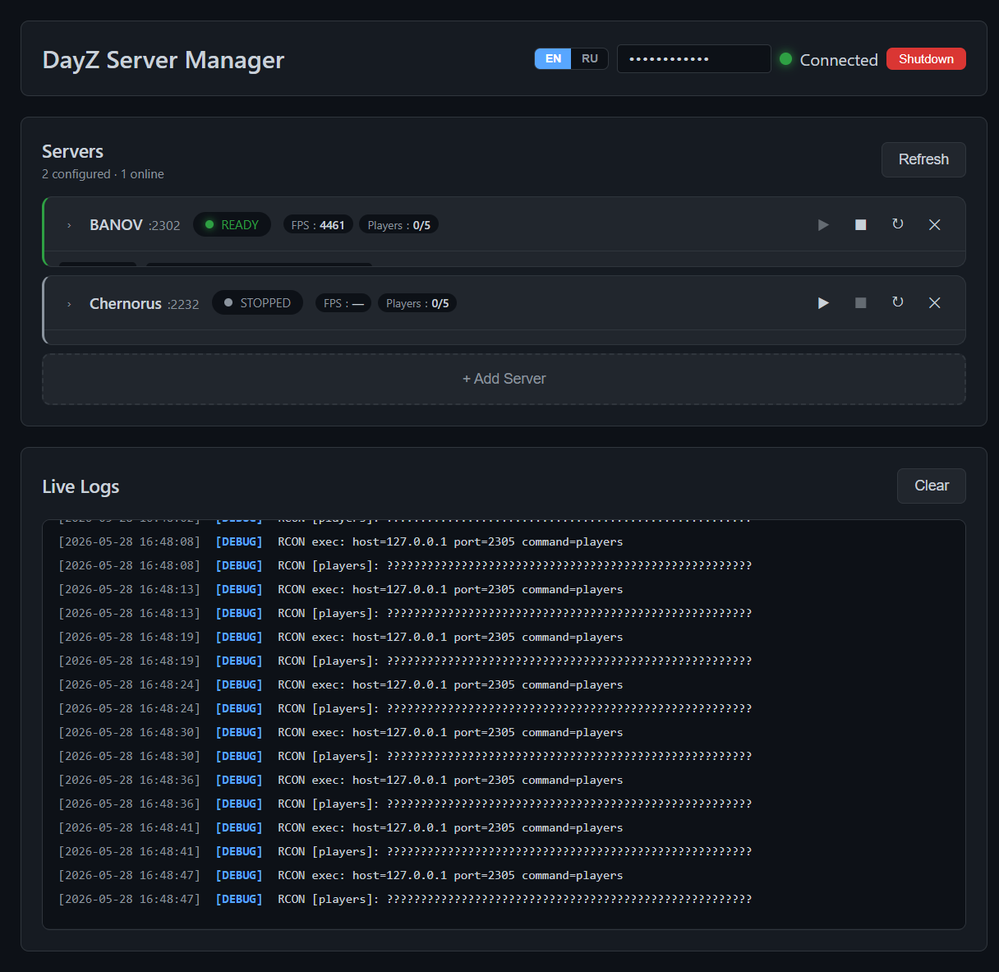
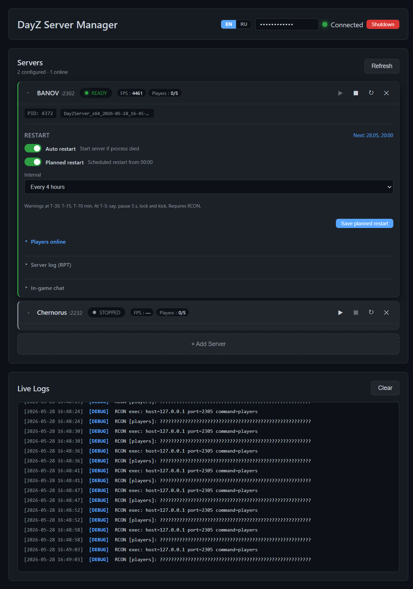

# DayZ Server Manager

**Languages:** [English](README.md) · [Русский](README.ru.md)

Надоели батники? Этот менеджер заменяет их удобным веб-интерфейсом.
Запускайте серверы, обновляйте моды, следите за игроками — всё из браузера.

> 👉 **Просто хотите запустить?** Скачайте EXE → распакуйте → соберите папку сервера → отредактируйте config.json → запустите. [С чего начать ↓](#с-чего-начать)

**Лицензия:** [MIT](LICENSE) · **Скачать:** [Releases](https://github.com/devmrbouh-hub/dayz_manager/releases)

## Скриншоты




## Что умеет

- Запуск / остановка / рестарт нескольких серверов из браузера
- WatchDog — автоперезапуск при падении
- Обновление модов через SteamCMD с предупреждениями игрокам (5 мин)
- Плановые рестарты с обратным отсчётом в игре (RU/EN)
- Live-статистика: FPS, список игроков с никами
- Игровой чат прямо в браузере
- RCON: say, kick, lock, graceful shutdown
- Один EXE для Windows — установка не нужна

Менеджер запускает папку, в которой уже лежат `DayZServer_x64.exe` и `serverDZ.cfg`. Скачивание DayZ Server, выбор модов, экономика, `types.xml` и миссия остаются за пределами этого README.

## С чего начать

Оба пути кончаются одним файлом `mod_list.txt` в папке сервера и одной кнопкой Start.

### Моды и bat

Батник менеджер не читает. Вместо строки `-mod=` в bat используйте `mod_list.txt`: те же `@Имя`, по одному на строку, порядок важен.

На каждом Start ModSync собирает `-mod=` из этого списка. Если папка `@Имя` уже лежит рядом с `DayZServer_x64.exe`, менеджер её не трогает, подхватывает мод и копирует `.bikey` в `keys/`. Если папки нет, при известном Workshop id создаёт junction `папка_сервера\@Имя` → `!Workshop\@Имя` → `content\221100\<id>`.

Цифровой id берётся из junction (путь ведёт в `content\221100\<id>`), из `servers[].mods` в `config.json` (`name` и `id`), не из одной строки в `mod_list.txt`. Обычная скопированная папка `@Мод` id для автообновления не даёт. Порядок в `-mod=` задаёт только `mod_list.txt`, не `servers[].mods`.

Если в списке есть имя, но нет ни папки у exe, ни цепочки Workshop, имя всё равно попадёт в `-mod=`, а мод в игре не поднимется — смотрите WARN в `logs/manager.log`.

**Первый раз на машине:** подпишитесь на моды и скачайте их **клиентским лаунчером DayZ** (или через Steam) в **ту же библиотеку**, что в `steam.dayz_install_path` и `steam.workshop_path`. Менеджер лаунчер не заменяет: без файлов в `steamapps\workshop\content\221100\<id>` junction не из чего собрать. После загрузки на Start он свяжет `@Имя` с уже лежащим content и соберёт `-mod=`. **Дальнейшие обновления** — через SteamCMD и ModCheck, если настроены `steam.*`, `servers[].mods` с id и установлен SteamCMD (перед стартом менеджер может один раз докачать отставшие моды, если ModCheck их увидел).

Подробности: [docs/ru/HOW_IT_WORKS.md](docs/ru/HOW_IT_WORKS.md) (ModSync и junction).

### Сервер ещё не запускали

1. В Steam откройте библиотеку, раздел инструментов, и установите **DayZ Server** в свою папку. Менеджер в эту папку не входит.
2. Создайте `mod_list.txt`: имена модов с `@`, как в Workshop или в гайде, по одному на строку, в порядке загрузки.
3. Подпишитесь на те же моды в **лаунчере** и дождитесь загрузки (`@Имя` как в `mod_list.txt`). Затем в `config.json` укажите пути `steam.*` и при необходимости пары `name`/`id` в `servers[].mods`, чтобы менеджер связал моды на Start и **обновлял** их через SteamCMD.
4. Копировать гигабайты модов в папку сервера **не нужно** — это лишь совместимость со старым bat.
5. Имя хоста в `serverDZ.cfg` поправьте по желанию. Пароль для входа игроков в этом файле необязателен.

### Уже есть папка и bat

Папку не разбирайте и моды переносить не нужно. Откройте bat, найдите `-mod=@CF;@Community-Online-Tools;...` и перепишите те же имена в `mod_list.txt`, каждое с новой строки, в том же порядке. Менеджер подхватит папки `@Мод`, которые уже лежат рядом с exe.

## config.json

1. Скачайте **`dayz_manager-*-windows-x64.zip`** из [Releases](https://github.com/devmrbouh-hub/dayz_manager/releases) и распакуйте.
2. Скопируйте `config\config-host-template.json` → `config\config.json`.

Шаблон — пример уже разложенного хоста. Для одной новой папки поправьте его так:

| Поле | Что сделать |
|------|-------------|
| `servers` | Оставить один объект. Второй сервер из шаблона удалить |
| `servers[].path` | Папка, где лежит `DayZServer_x64.exe` |
| `servers[].config_file` | Путь к `serverDZ.cfg`, который есть на диске. В шаблоне стоит `Instance_1\\serverDZ.cfg`. У свежей установки Steam файл обычно в корне: `serverDZ.cfg` |
| `servers[].server_mods` | Очистить, если папки `@ServerMod` нет. Иначе в запуск попадёт `-servermod=@ServerMod` |
| `servers[].mods_file` | Оставить `mod_list.txt` |
| `servers[].mods` | Опционально: `{ "name": "@CF", "id": "123456789" }` для Workshop id, когда junction ещё нет. Порядок launch не меняет |
| `auth.api_key` | Своя строка вместо `change_this_api_key`. С шаблонным значением менеджер не запускается. Её вводят на странице http://127.0.0.1:8000. Это не пароль игроков и не пароль BattlEye. Блок `auth.users` страница не спрашивает |
| `servers[].rcon_password`, `rcon.password`, `rcon.port`, `rcon_port` | Те же `RConPassword` и `RConPort`, что в вашем `BEServer_*.cfg`. В шаблоне порт 2304, у вас он может быть другим |

**Минимум для Start**, если `@Мод` уже лежат у exe (как после bat): `servers[].path`, `auth.api_key`, RCON, верный `config_file`.

**Для junction и ModCheck:** `steam.steamcmd_path`, `steam.dayz_install_path`, `steam.workshop_path` и `servers[].mods` с id (или junction после лаунчера). SteamCMD — для **обновлений**, не для первой подписки; первичная загрузка — лаунчер в ту же библиотеку. Пути: [docs/ru/CONFIG.md](docs/ru/CONFIG.md). Junction: [docs/ru/HOW_IT_WORKS.md](docs/ru/HOW_IT_WORKS.md).

При Start менеджер копирует `.bikey` из папки `@Мод` у сервера или из `!Workshop`, куда смотрит junction.

3. Запустите `DayZManager.exe`.
4. Откройте **http://127.0.0.1:8000** и введите `auth.api_key`.

BattlEye, порты и firewall: [docs/ru/DEPLOY.md](docs/ru/DEPLOY.md). Полный справочник полей: [docs/ru/CONFIG.md](docs/ru/CONFIG.md).

## Production (хост)

### Вариант A — скачать Release (без сборки)

1. **[Releases](https://github.com/devmrbouh-hub/dayz_manager/releases)** → архив **`dayz_manager-*-windows-x64.zip`**
2. Распаковать; `config\config-host-template.json` → `config\config.json` и заполнить по разделу [config.json](#configjson)
3. Запустить `DayZManager.exe` → http://127.0.0.1:8000

Инструкция: [docs/ru/RELEASES.md](docs/ru/RELEASES.md)

### Вариант B — собрать из исходников

1. `build.bat` → `dist\DayZManager.exe` (нужен `bercon-cli.exe` в корне проекта)
2. Скопировать EXE на хост; **не перезаписывать** рабочий `config.json`
3. Шаблоны: `config/config-host-template.json`, `config/config-host-nru90-template.json`

Подробно: [docs/ru/DEPLOY.md](docs/ru/DEPLOY.md), чеклист: [docs/ru/RUNBOOK.md](docs/ru/RUNBOOK.md).

## Структура

```
dayz_manager/
├── src/           # Python: core, api, notifications
├── web/           # UI
├── config/        # config.json (локально, в .gitignore)
├── hooks/         # Кастомные хуки
├── scripts/       # опциональные helper-скрипты
├── docs/          # документация (EN); docs/ru/ — русский
├── build.bat
└── README.md
```

## Ветка и релизы

Актуальная ветка: **`main`**. Фазы стабилизации и admin UI (planned restart, live stats, чат) влиты — см. [CHANGELOG.md](docs/ru/CHANGELOG.md) и [ROADMAP.md](docs/ru/ROADMAP.md).

Планы масштабирования (интернет, карта, магазин, SaaS): [docs/ru/PRODUCT_ARCHITECTURE.md](docs/ru/PRODUCT_ARCHITECTURE.md).

## Опциональные helper-скрипты

Не обязательны для первого запуска. Сервер: `DAYZ_MANAGER_SERVER` или первый в `config.json`.

```powershell
python scripts/test_stability_local.py
python scripts/start_server_direct.py   # sync + start без SteamCMD pre-download
```

См. [docs/ru/TESTING.md](docs/ru/TESTING.md).
