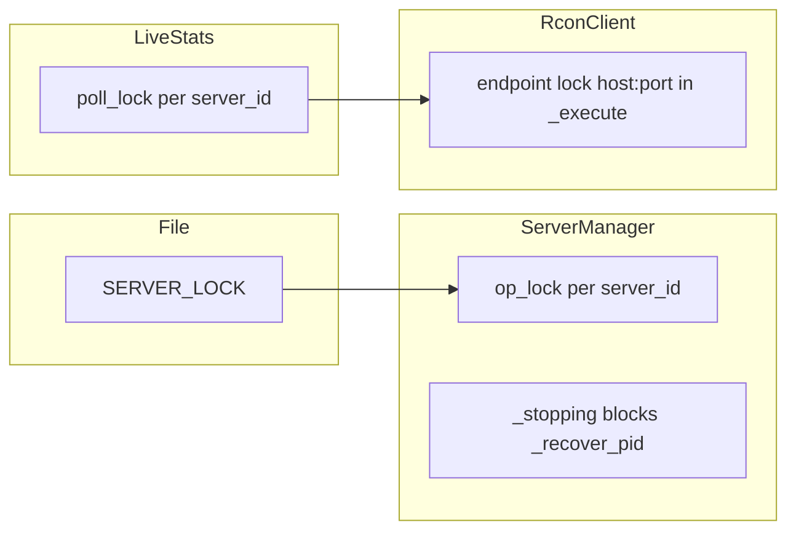

# Ревью изменений с v1.0.5

**Дата:** 2026-10-14  
**База:** тег `v1.0.5` (`bc7fd8e`)  
**HEAD:** `461d60e` (`main`)  
**Дельта:** 5 коммитов, 39 файлов (+2042 / −671)

**Язык:** русский (EN-зеркало по плану не создавалось).

---

## Резюме

С v1.0.5 до текущего `main` накопились три «версионных» темы (пути Steam/ModSync, live stats и окно кика, multi-decode `players`) и один крупный блок **управления процессом** (`6e21bee`), плюс онбординг в документации. Локально **`python -m pytest tests` — 122 passed**; на GitHub Actions последний успешный прогон — push `461d60e` (включает весь код до HEAD).

**Вердикт:** для выкладки на хост **код выглядит согласованным с [AGENTS.md](../../AGENTS.md) и тестами**; главный остаточный риск — поведение **frozen EXE** (shutdown, `manager.pid`, WatchDog) без полного автотеста API shutdown и без обязательного прогона чеклиста на игровом сервере. **Релизная дисциплина отстаёт:** на GitHub опубликован только **v1.0.8**; коммиты v1.0.6/v1.0.7 без тегов; **process control после v1.0.8 не выпущен** — админу стоит собирать/выкладывать **v1.0.9** (или явно помечать сборку по коммиту).

---

## Карта коммитов и релизов

| Коммит | Смысл (CHANGELOG) | Git-тег | GitHub Release | RELEASE_NOTES в репо |
|--------|-------------------|---------|----------------|----------------------|
| `c49f4a2` | v1.0.6 — Steam library, `dayz_install_path`, junction ModSync, ModCheck | нет | нет | нет |
| `3a1137b` | v1.0.7 — `players/refresh`, окно кика 3–5 мин, RCON lock в live stats | нет | нет | `v1.0.7.md` **не в git** (только локально, если есть) |
| `417215d` | v1.0.8 — decode `players` | **v1.0.8** | **v1.0.8** | `v1.0.8.md` |
| `6e21bee` | Process control (WatchDog, `.stopped`, shutdown, mod groups, T-0 долг, RCON queue, `manager.pid`) | нет | нет | правки в `v1.0.8.md` в том же коммите (release notes не отражают process control) |
| `461d60e` | Онбординг, `AGENTS.md` | нет | нет | — |

**CHANGELOG:** между секциями **v1.0.6** и **v1.0.4** остаётся блок без заголовка версии (тихий RCON `players`, cp866, сжатый лог `.bikey`) — по смыслу это содержимое **v1.0.5**, уже внутри тега `v1.0.5`, не часть дельты `v1.0.5..HEAD`.

### Файлы по блокам (inventory)

| Блок | Коммиты | Ключевые пути |
|------|---------|----------------|
| **A** | `c49f4a2`, частично `6e21bee` (`mod_sync`) | `steam_paths.py`, `steamcmd.py`, `mod_sync.py`, тесты steam_* |
| **B** | `3a1137b` | `server_live_stats.py`, `scheduler.py`, `planned_restart.py`, `routes.py`, `web/js/app.js`, тесты live_stats / planned_restart_kick |
| **C** | `3a1137b`, `417215d`, `6e21bee` | `rcon_client.py`, `test_live_stats.py` |
| **D** | `6e21bee` | `server_mgr.py`, `scheduler.py`, `routes.py`, `main.py`, `mod_sync.py`, `rcon_client.py`, `test_process_control.py`, `test_server_mgr_rpt.py` |
| **E** | `6e21bee`, `461d60e` | HOW_IT_WORKS, RUNBOOK, CHANGELOG; README, DEPLOY, CONFIG, INDEX, ROADMAP, `AGENTS.md` |
| **F** | все | pytest, CI, теги/релизы |

---

## Таблица блоков A–F

| Блок | Зачем | Что сделано | Правильно ли | Вердикт | Риски |
|------|-------|-------------|--------------|---------|-------|
| **A** v1.0.6 | Неверный `force_install_dir` (корень диска), mismatch модов, junction `!Workshop` не на `content/221100` | `resolve_steam_library_path` / `resolve_workshop_content_root`; ERROR при `is_suspicious_steam_library`; пересоздание junction; ModCheck без mtime-цикла | Тесты `test_steam_paths`, `test_steamcmd_mod_cache`; логика путей читается последовательно | **Ок** | Неверный `steam.dayz_install_path` в config по-прежнему ломает хост — доки CONFIG/DEPLOY это подчёркивают |
| **B** v1.0.7 | 0 игроков на карточке между опросами; кик только в узком окне; гонки RCON | `_poll_one_server` + per-server poll-lock; `POST .../players/refresh`; окно 3–5 мин в `planned_restart.in_kick_window`; say/kick только после успешного RCON test | Тесты live_stats и planned_restart_kick; poll-lock берётся **до** вызова RCON; очередь host:port в `_execute` — отдельный слой (D/C) | **Ок** | [docs/ru/API.md](API.md) не описывает `players/refresh` (EN [docs/API.md](../API.md) описывает) |
| **C** v1.0.8 | Имена игроков не парсились при не-cp866 | Multi-decode cp866/cp1251/utf-8 по числу строк; tie → cp866; `_RCON_QUIET_COMMANDS` для `players` сохранён | Тесты decode в `test_live_stats`; WARN один раз на host:port при «сырой ответ есть, строк 0» | **Ок** | Host-verification в CHANGELOG — заявление автора релиза, не автотест |
| **D** process control | Автостарт после Stop, resurrect pid, два экземпляра менеджера, mod restart vs T-0 | `.stopped` только `manual`; WatchDog baseline; `SERVER_LOCK` до op lock; `_stopping` блокирует `_recover_pid`; `_mod_groups` / `_owed_planned`; RCON lock в `_execute`; `manager.pid`; API shutdown → scheduler stop → manual stop → SIGINT | `test_process_control.py`, `test_scheduler_locks.py`, регрессия RPT; соответствие AGENTS.md | **Ок с оговорками** | Нет интеграционного теста `POST /api/shutdown` и SIGINT/lifespan; поведение EXE — чеклист на хосте |
| **E** документация | Онбординг без «копируйте моды»; карта для агентов | README два пути → `mod_list.txt`; лаунчер + ModSync; `AGENTS.md`; HOW_IT_WORKS про process control и окно кика | Противоречия «кладите моды в папку» нет; якорь `#моды-и-bat` в README.ru — заголовок `### Моды и bat` (GitHub slug может отличаться) | **Ок с оговорками** | ROADMAP/CONFIG/TESTING всё ещё формулируют kick как **T-5**, код — **окно 3–5 мин** (HOW_IT_WORKS актуальнее) |
| **F** сквозное | Уверенность в регрессии и релизах | 122 теста; CI success на `461d60e` | Локально зелёно | **Ок** | Нет тегов v1.0.6/1.0.7; EXE на хосте часто = v1.0.8 без `6e21bee` |

**Auth / Discord / парсеры RPT и чата** в дельте `v1.0.5..HEAD` **не менялись** (кроме косвенного использования RCON).

---

## Архитектура блокировок (после дельты)

Владельцы не размыты: процесс и `.stopped` — `ServerManager`; расписание, mod groups, T-0 долг — `Scheduler`; очередь RCON на endpoint — `RconClient`. `say` не участвует в выборе остановки и не сдвигает слот рестарта (проверено в scheduler + тестах).

---

## Дефекты и пробелы (P0 / P1 / P2)

### P0 (блокер продакшена)

*Не выявлено* при ревью кода и полном pytest на HEAD. Остаточные P0 возможны только на хосте (см. чеклист).

### P1 (важно до/сразу после следующего EXE)

| ID | Область | Описание |
|----|---------|----------|
| P1-1 | Релиз | На GitHub **нет сборки** с `6e21bee`+`461d60e`; админы на v1.0.8 **не получают** process control |
| P1-2 | Тесты | Нет автотеста цепочки `shutdown_manager` (scheduler stop → manual stop всех → выход) |
| P1-3 | RELEASE_NOTES | `6e21bee` менял `.github/RELEASE_NOTES/v1.0.8.md`, но релиз v1.0.8 уже про encoding — process control в release notes не отражён |

### P2 (доки / дисциплина)

| ID | Область | Описание |
|----|---------|----------|
| P2-1 | Доки RU | [docs/ru/API.md](API.md): нет строки `POST /api/servers/{id}/players/refresh` |
| P2-2 | Доки | [docs/ru/ROADMAP.md](ROADMAP.md) п. **1.4**, [docs/ru/CONFIG.md](CONFIG.md), [docs/ru/TESTING.md](TESTING.md) — kick на **T-5**; код и [HOW_IT_WORKS.md](HOW_IT_WORKS.md) — **окно T-5…T-3** |
| P2-3 | Релизы | Нет git-тегов **v1.0.6**, **v1.0.7**; сложно сопоставить EXE на диске с CHANGELOG |
| P2-4 | CHANGELOG | Висячий блок между v1.0.6 и v1.0.4 без номера версии (см. выше) |
| P2-5 | RELEASE_NOTES | Файл `v1.0.7.md` не отслеживается в git (если нужен — добавить или не полагаться на него) |

---

## Рекомендации (без автоматического выполнения)

1. Выпустить **v1.0.9** (тег + GitHub Release + EXE) с `6e21bee` и док-коммитом `461d60e`; release notes отдельной секцией «Process control».
2. После релиза: дописать `players/refresh` в `docs/ru/API.md`; выровнять ROADMAP/CONFIG/TESTING с окном 3–5 мин.
3. По желанию: теги v1.0.6/v1.0.7 на исторические коммиты только для трассировки (не обязательно, если есть v1.0.9).

---

## Чеклист на игровом хосте (после следующего EXE)

Подтверждено тестами в CI/local — **не заменяет** эти сценарии на реальном сервере.

1. **WatchDog:** сервер уже остановлен при старте менеджера — **не** автостартует на первом опросе; после падения процесса при `auto_restart` — поднимается.
2. **Stop:** `.stopped` появляется до убийства процесса; после Stop WatchDog **не** воскрешает сервер.
3. **Restart / mod update:** `.stopped` **не** создаётся; planned/mod restart работает.
4. **Закрытие окна** vs **Shutdown в UI/API:** при закрытии окна игровые серверы остаются; при Shutdown — останавливаются, менеджер выходит; второй exe при живом первом — отказ (`manager.pid`).
5. **Planned restart:** say на T-30/15/10; в окне 3–5 мин — say → lock → kick; T-0 не сдвигается из-за say; при SERVER_LOCK — долг T-0 (`_owed_planned`).
6. **Игроки:** счётчик и refresh; кириллические ники; в логе нет спама каждые 5 с по `players` (только WARN при сбое/0 parse).
7. **Моды:** неверный junction пересоздаётся; SteamCMD не уходит в корень диска при правильном `dayz_install_path`.

---

## Метод

- `git log` / `git diff v1.0.5..HEAD`, разбор коммитов по файлам  
- `python -m pytest tests` — **122 passed** (2026-10-14, локально)  
- `gh run list` — success на `461d60e`  
- Чтение кода: `server_mgr.py`, `scheduler.py`, `rcon_client.py`, `server_live_stats.py`, `steam_paths.py`, `mod_sync.py`, `routes.py`, `main.py`  
- Сверка с `AGENTS.md`, README, API EN/RU, ROADMAP  

Фиксы по P1/P2 в этом проходе **не вносились** — только отчёт.
